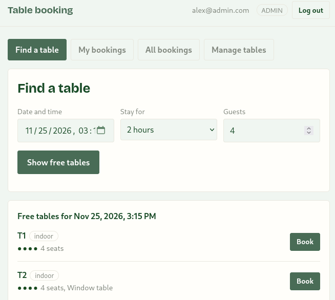
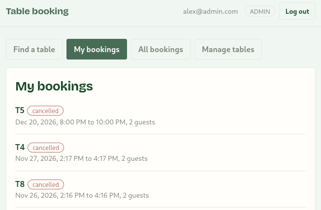
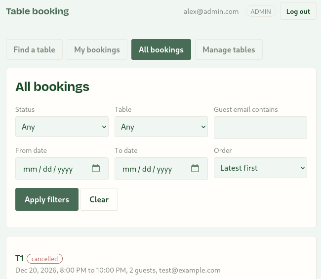
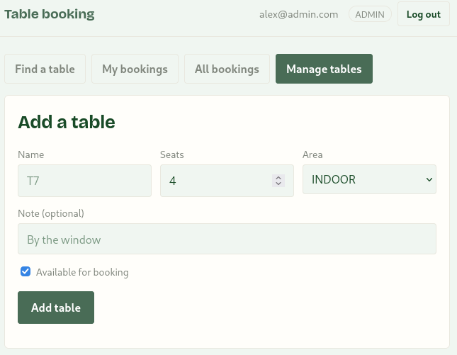
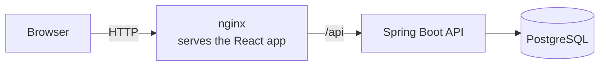

# Table Booking

[](https://github.com/m-ello/booking-system-j/actions/workflows/ci.yml)

A full-stack restaurant table reservation system. Guests search for free tables by date, time and party size, then book and cancel them. Admins manage the floor plan and see every booking. The part I spent the most time on: **two people can never book the same table for overlapping times, even when their requests arrive at the same instant.**

**Stack:** Java 21, Spring Boot 4, Spring Security (JWT), Spring Data JPA, PostgreSQL 16, Flyway, OpenAPI (Swagger UI), React, TypeScript, Vite, TanStack Query, Docker Compose, nginx, GitHub Actions.

## Screenshots

| Find a table | My bookings |
|---|---|
|  |  |

| Admin: all bookings | Admin: manage tables |
|---|---|
|  |  |

## Features

**Guests**
- Register and log in (JWT, 60-minute sessions)
- Search free tables for a start time, stay length (1 to 3 hours) and number of guests
- Book a table, see "My bookings", cancel a booking (at least 2 hours before it starts)

**Admins**
- Add, edit, deactivate and reactivate tables (name, seats, area, note)
- Browse all bookings with filters (status, table, guest email, date range), sorting and pagination
- Cancel any booking

**Engineering**
- Double bookings are impossible under concurrency (see [below](#preventing-double-bookings))
- Role-based access control enforced on the server
- Versioned database migrations, OpenAPI documentation, automated tests at three levels, CI on every push

## Architecture



The browser only talks to nginx, which serves the built React files and forwards `/api` requests to the Spring Boot container. This means no CORS configuration is needed, in development (Vite's dev proxy) or in production.

The backend is organised by feature (`auth`, `booking`, `diningtable`, `user`), each with the same layers:

```
Controller   HTTP only: routes, validation, status codes
   ↓
Service      business rules and transactions
   ↓
Repository   database access (Spring Data JPA)
```

Controllers exchange DTOs (Java records) with clients. Entities never leave the service layer.

## Quick start

Requires Docker.

```bash
git clone https://github.com/m-ello/booking-system-j.git
cd booking-system

cp .env.example .env
# edit .env and set JWT_SECRET to a random value of at least 32 characters, for example:
#   openssl rand -base64 48

docker compose up --build
```

| What | Where |
|---|---|
| Web app | http://localhost:3000 |
| API documentation (Swagger UI) | http://localhost:3000/swagger-ui.html |
| API directly | http://localhost:8080 |

**Create an admin.** Public registration always creates a normal user, so promote one directly in the database, then log in again (the role is stored in the token):

```bash
docker exec -it booking-db psql -U booking -d booking \
  -c "UPDATE users SET role = 'ADMIN' WHERE email = 'you@example.com';"
```

The database credentials in `docker-compose.yml` are for local use only.

## Local development

```bash
# 1. database only
docker compose up -d db

# 2. backend (needs JWT_SECRET in the environment or in .env)
./mvnw spring-boot:run

# 3. frontend, in another terminal (Node 20.19+ or 22.12+)
cd frontend
npm install
npm run dev          # http://localhost:5173, /api is proxied to port 8080
```

## API overview

Full interactive documentation is in Swagger UI. In Swagger, log in through `POST /api/auth/login`, copy the `accessToken`, and press **Authorize**.

| Method and path | Access | Purpose |
|---|---|---|
| `POST /api/auth/register`, `/login` | public | Create an account, get a token |
| `GET /api/tables/available?start&end&partySize` | user | Free tables for a time range |
| `GET /api/tables`, `GET /api/tables/{id}` | user | List and read tables |
| `POST`, `PUT`, `DELETE /api/tables` | admin | Manage tables (delete deactivates) |
| `POST /api/bookings` | user | Book a table |
| `GET /api/bookings/my` | user | My bookings |
| `GET /api/bookings/{id}` | owner or admin | One booking |
| `DELETE /api/bookings/{id}` | owner or admin | Cancel a booking |
| `GET /api/bookings` | admin | All bookings: filters, sort, pagination |

Errors use the standard Problem Details format (RFC 9457), with a field-by-field `errors` map for validation failures.

## Design decisions

### Preventing double bookings

A booking is accepted only if no other active booking on the same table overlaps its time range. A check-then-insert in Java is not enough: two simultaneous requests can both see "free" before either saves. The final design has three layers:

1. **Row lock per table.** Creating a booking first locks the table's row (`SELECT ... FOR UPDATE`). Requests for the same table queue up, and each one runs its overlap check after the previous one has committed. The losers get a clean `409 Conflict`. Requests for different tables never wait for each other.
2. **Overlap check in the service**, which produces the friendly error message.
3. **A PostgreSQL exclusion constraint** (`EXCLUDE USING gist` on the table and a `tstzrange` of the booking time) as a safety net, so even a bug in the Java code or a manual SQL insert cannot create an overlap.

I started with only the exclusion constraint. Under heavy contention PostgreSQL then aborted many of the concurrent inserts with deadlock errors instead of a clean rejection, which is why the row lock was added. A concurrency test sends 20 simultaneous requests for the same slot and asserts that exactly one succeeds and 19 receive `409`.

Details that follow from the time-range semantics: a booking that ends at 20:00 does not conflict with one that starts at 20:00, and cancelled bookings never block a slot.

### Time handling

All times are `Instant` in Java and `TIMESTAMPTZ` in PostgreSQL, exchanged as UTC ISO-8601 strings. The browser converts to and from the user's local time zone, so the server stays time-zone independent. Services take a `Clock`, which lets tests freeze time.

### Security

- Passwords are hashed with BCrypt. Emails are trimmed and lower-cased.
- Stateless JWT (HS256) authentication; the role claim drives authorization. The signing secret comes from the environment and the app refuses to start with a secret shorter than 32 bytes.
- Login failures give the same message for an unknown email and a wrong password.
- A user asking for someone else's booking gets `404`, not `403`, so booking ids cannot be probed.
- Sorting accepts only a whitelist of fields, and page size is capped.
- Admin endpoints are protected on the server. The frontend hides admin links only for convenience.

### Data model and migrations

Three tables (`users`, `dining_tables`, `bookings`) managed by Flyway migrations: `V1` creates the schema, `V2` evolves it from a generic "resource" model into restaurant tables (a rename migration that keeps existing data), and `V3` adds the exclusion constraint. Hibernate only validates the schema (`ddl-auto: validate`), so migrations are the single source of truth. Tables are deactivated instead of deleted, which preserves booking history.

## Testing

```bash
./mvnw verify            # backend (Docker must be running)
cd frontend && npm test  # frontend
```

**Backend**
- Unit tests with Mockito and a fixed clock for the booking rules and cancellation policy
- Integration tests against a real PostgreSQL started by Testcontainers, sending HTTP requests through the full security filter chain: authentication, authorization, overlap rules, availability, cancellation, pagination and filters
- Repository tests for the overlap query edge cases and the exclusion constraint itself
- A concurrency test with 20 parallel requests for one slot

**Frontend**
- Vitest and Testing Library for components, the route guard and the login form

GitHub Actions runs backend tests, frontend lint, tests and build, and builds both Docker images on every push and pull request.

## Project structure

```
.
├── src/main/java/.../      Spring Boot backend (auth, booking, diningtable, user, config, common)
├── src/main/resources/
│   └── db/migration/       Flyway migrations
├── src/test/               unit and integration tests
├── frontend/               React + TypeScript + Vite app, Dockerfile and nginx config
├── docker-compose.yml      database, API and web
├── Dockerfile              backend image (multi-stage)
└── .github/workflows/      CI
```

## Limitations and possible next steps

- Opening hours per table, so bookings outside service hours are rejected
- Waiting list for fully booked slots
- Refresh tokens (today a user logs in again after 60 minutes) and rate limiting on login
- The token is kept in `localStorage`, which is simple but readable by any injected script. HTTP-only cookies would be the more hardened option.
- Spring Security's `401` and `403` responses have an empty body. Custom handlers would make them match the rest of the error format.
- Email confirmations and reminders
- Metrics and health checks (Spring Boot Actuator) and a deployment target
